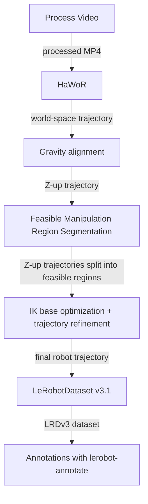

# Codebase cleanup and integrated pipeline

Draft · revision 2 · 2026-11-03 · Awaiting explicit implementation approval.
Request/defaults: `20261103-cleanup-plan-001`; deprecation clarification:
`20261103-cleanup-plan-003` in the
[November action log](../logs/2026-11.jsonl).

## Objective and deliverable

Deliver a smaller codebase and one reproducible MP4-to-annotated-robot-dataset workflow
for Milestone 3, including robot-to-LeRobot integration:

## Scope and boundaries

- Promote **full base + IK** using the exact saved
  [held-out `slack5-orientation8` settings](../../../outputs/ik-benchmark-heldout-20261103/slack5-orientation8.json)
  (local evidence) and accepted left +180° / original-right Config 2 mapping. Preserve smoothing,
  limits, weights, CUDA backend, one attempt and 700/1000 evaluation caps. Fit
  base and sampled poses jointly, then refine with that base fixed per region.
  Process all retained regions; SDF and benchmark-only selections stay experimental.
- Keep **one full input video per LeRobot episode**, including gaps. Region
  metadata records half-open frame/time intervals in episode and source time,
  fixed-base transforms and feasibility outcomes. Export synchronized joint/gripper
  trajectories with explicit validity; leave unsolved frames invalid and do not
  synthesize motion between regions. Preserve RGB, original world/canonical hands,
  Z-up geometry, units, handedness, timestamps and missing/infilled provenance.
  Candidate segmentation does not certify IK feasibility. Reject incompatible appends.
  Preserve historical datasets as evidence; retire the hand-only export workflow.
- Keep annotation after v3.1 export. Modified HaWoR, annotation reordering, solver
  retuning, new simulation and hardware execution are excluded. Existing tracking
  and collision failures remain visible; cleanup does not complete milestone acceptance.

## Subphases

1. **Evidence and defaults:** move all identified Milestone 2 experiment outputs
   into `outputs/milestone-2/`, including milestone-owned artifacts in mixed setup
   directories. Preserve shared setup evidence and original inputs. Record relocations
   and repair active consumers/links without rewriting historical logs. Separate
   `configs/defaults/` from `configs/experiments/`; commit the accepted solver settings
   as defaults rather than depending on ignored benchmark files.
2. **Executable workflow:** put primary processing entry points in `pipeline/`;
   reserve `scripts/` for setup, benchmarks, diagnostics and viewers. Group `src/`
   by video ingestion, tracking, geometry, retargeting, datasets/annotations,
   evaluation and visualization. Remove `scripts/video_to_dataset.py` and other deprecated
   scripts, code, configs and tests; migrate active consumers and documentation.
   Reuse needed functionality in the new pipeline, without legacy compatibility wrappers.
   Add minimal `pipeline/run.sh` chaining stages with explicit
   interpreters, logs and failure propagation; support existing intermediate reuse.
3. **Setup and usability:** audit environments/dependency conflicts; consolidate
   compatible modern stages with reproducible declarations and explicit interpreter
   selection. Retain necessary HaWoR/VLM isolation; verify replacements before retiring
   environments. Shorten README to purpose, setup, one pipeline example and reference
   links. Finally update existing CI paths and focused CPU/integration checks;
   broader CI modernization is low priority and deferred.

## Acceptance

- Verify relocated evidence/links and removal of deprecated entry points and active references.
- Run focused import/CLI, stage-contract and dataset create/append/annotation tests.
  Check full-video episode counts, gap/region boundaries, transforms, synchronization,
  validity and unchanged prior episodes/annotations with the official reader.
- Run the shell workflow on one small complete video; reuse saved iPhone multi-region
  evidence to verify export boundaries and frozen-config parity. Inspect representative
  video/trajectory views, including gaps and base changes. Record environment smoke
  checks and limitations; no expensive benchmark sweep is required.
- Save logs/reports/visuals under `outputs/cleanup/`; update wiki/status and commit
  coherent verified subphases.
